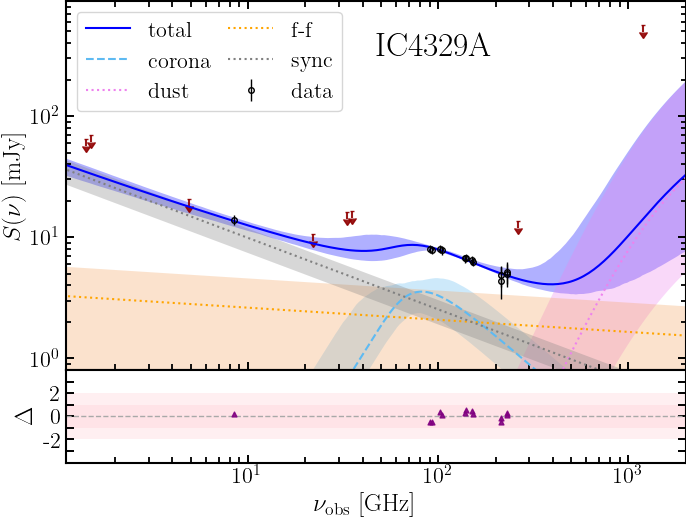

# SMBH Corona SED Fitter

Fit radio-to-far-infrared spectral energy distributions with a hybrid thermal
and non-thermal black-hole corona model plus dust, free-free, and extended
synchrotron components.



*Example SED showing the model components and 1-sigma confidence intervals.*

## Quick start

Supported runtime: Python 3.10 or newer and Bilby 2.8.2 or newer.

From the repository root, install and run the bundled NGC985 example:

```bash
python -m pip install -r requirements.txt
python -m pip install -e .
python scripts/galaxy_sed.py NGC985
```

The fit, posterior corner plot, and SED plot are written to `outdir/NGC985/`.
The main summaries are `fit_summary.json` and `derived_summary.json`. A new fit
replaces the previous outputs for that source.

To regenerate the SED plot from an existing fit without fitting again:

```bash
python scripts/galaxy_sed.py NGC985 --fit=False
```

SED plotting uses LaTeX. Install a LaTeX distribution if plot generation fails
because `latex` is unavailable.

## Run a fit for your source

For a source named `SOURCE`, provide its parameter and flux files:

```text
data/parameters/SOURCE.par
data/fluxes/SOURCE_flux.dat
```

The parameter file is a JSON dictionary. The flux file has six whitespace-
separated columns:

```text
frequency_GHz flux_mJy flux_error_mJy beam_major_arcsec beam_minor_arcsec flag
```

Flags are `0` for detections, `1` for upper limits, `2` for fake/diagnostic
points (e.g. for simulations when preparing observing proposals), and `4` for 
lower limits. Statistical uncertainties are combined with the configured systematic 
error during data loading.

Optional source settings live in `data/configs/SOURCE_config.json`. If this file
is missing, the script copies `default_config.json` and immediately continues
with the fit. Create or review the config before running if the default fit
parameters, model settings, or output location are not appropriate. The config's
`output.root` setting controls where run files are written.

To store input data outside the checkout, set `SMBH_CORONA_DATA_PATH` to a
directory containing all three data subdirectories:

```text
parameters/
fluxes/
configs/
```

For example:

```bash
export SMBH_CORONA_DATA_PATH=/path/to/smbh-corona-data
python scripts/galaxy_sed.py SOURCE
```

The wheel does not include observational data; non-editable installations must
use this external-data setting.

`derived_summary.json` includes empirical total and corona-only luminosities
corrected for magnification, plus direct corona diagnostics. `S_peak_mJy` is the
observed model flux including magnification; peak frequencies are given in
observed and rest frames. R23, K22, and V26a correlation functions warn when
their input luminosities are outside the quoted calibration range.

## Tests and validation

Run the test suite with:

```bash
python -m pip install -r requirements-dev.txt
python -m pytest -q
```

The suite includes a short synthetic fit-recovery check. Longer standalone
validations are available for mixed upper/lower limits and the empirical
correlation plots:

```bash
MPLBACKEND=Agg python tests/validation_test/fit_mock_limits.py
MPLBACKEND=Agg python tests/validation_test/plot_correlations.py
```

The mock validation scripts generate files under `data/fluxes/` and
`tests/validation_test/validation_output/`.

## Citation

If you use this model, please cite:

- del Palacio et al. (2025), *Astronomy & Astrophysics*, 701, 41,
  [main reference paper](https://ui.adsabs.harvard.edu/abs/2025A%26A...701A..41D/abstract).


Other relevant references:

- Inoue et al. (2019), [corona model](https://ui.adsabs.harvard.edu/#abs/2019ApJ...880...40I/abstract).
- Margalit & Quataert (2021, 2024),
  [thermal-synchrotron implementation](https://github.com/bmargalit/thermal-synchrotron).
- Mutie et al. (2024), [application to NGC 1068](https://ui.adsabs.harvard.edu/abs/2025MNRAS.539..808M/abstract).
